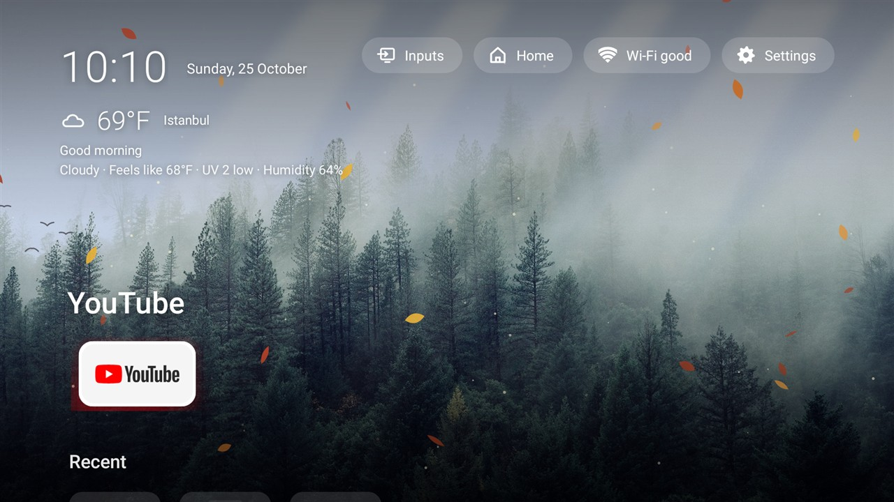

# Lumen: an ad-free, glass-style Google TV launcher

A small (~360 KB) home screen for Android / Google TV with a frosted-glass look.
No ads, no recommendations, no tracking. Internet is used only for the optional weather and the local photo upload (see below).



## Features
Lumen 2 has one look, **Winter Snowfall**: a misty forest with gently falling snow, laid out like Google TV.

- **Info panel** (top left): clock and date, optional live weather, a status line
  (room · Wi-Fi · data used today · sleep timer) and a greeting
- **Pills** (top right): Inputs, Wi-Fi, Settings
- **Favourites tray** with the selected app's name in large type, then **Recent** and **All apps**
- **Live scene**: the picture is re-lit for dawn, day, dusk and night, with animated weather
  (snow, rain, storm, fog, clouds), sunbeams and birds on clear days, fireflies on clear nights,
  and seasonal leaves, blossom and flurries
- **Your own background**: Settings → Upload picture from phone shows an address; open it on your
  phone (same Wi-Fi), pick a photo and it becomes the background. Or copy pictures to `Android/data/com.home.tvlauncher/files/backgrounds/`
  on the TV, then Settings → Background picture. The live scene keeps working on top of it.
- Long-press OK on an app: add to favourites, move, rename, hide, app info
- Settings panel: weather city and units, room name, clock format, hidden apps, input names,
  sleep timer, screensaver, navigation sounds
- Optional accessibility service so the remote's Home button opens Lumen
- Internet is used **only** for the optional weather and the local photo upload (see Network and privacy)

Looking for the themes, wallpapers and card styles of Lumen 1? They live on the
[`v1` branch](../../tree/v1).

## Tested on
TCL Smart TV Pro (G03_4K_US), Google TV 11 (Android 11), firmware GTV93, debloated with
[cleanyourtv](https://github.com/Gathin23/cleanyourtv). Also runs in the Android TV 11 emulator.

## Network and privacy
- **Weather** (optional, off until you set a city): your city name is sent to
  [Open-Meteo](https://open-meteo.com/) for the forecast. No account, no key.
- **Upload picture from phone**: a small web page served on your home network only while that screen
  is open on the TV; it accepts one image at a time and closes when you press Done.
- Nothing else: no ads, no analytics, no tracking, no accounts.

## Install on your TV
1. Download `lumen.apk` from the [latest release](../../releases/latest).
2. Get it onto the TV, either:
   - **From a PC with ADB:** enable *Developer options* and *USB debugging* on the TV, then
     `adb connect <tv-ip>` and `adb install lumen.apk`, or
   - **On the TV:** install the *Downloader* app from the Play Store, allow it to install unknown apps,
     and open the release link.
3. Open **Lumen** from your apps.
4. To make the remote's Home button open it: Settings → System → Accessibility →
   turn on **Lumen - Home button** (or use the side panel → Home button setup).
5. Some TVs (TCL among them) switch that off at every restart. To have Lumen turn it back on whenever
   it opens, grant it once over ADB:
   `adb shell pm grant com.home.tvlauncher android.permission.WRITE_SECURE_SETTINGS`

To undo: turn that service off, or uninstall the app.

Should work on Android TV / Google TV 9 and newer.

## Build from source (no Gradle)
Needs JDK 17 and Android SDK `build-tools;34.0.0` + `platforms;android-30`.

```sh
sh build.sh              # outputs build/lumen.apk
adb install -r build/lumen.apk
```

Then on the TV: Settings → System → Accessibility → turn on **Lumen - Home button**.

## License
MIT  see [LICENSE](LICENSE).
